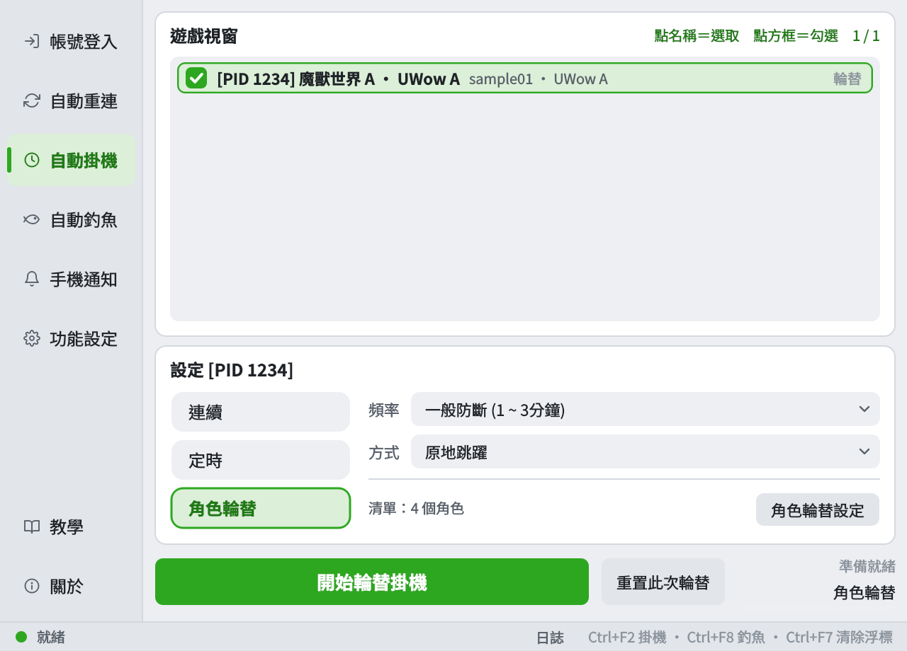
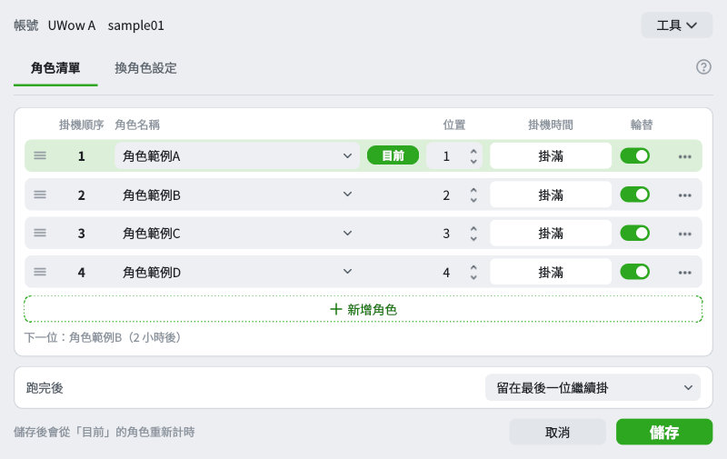
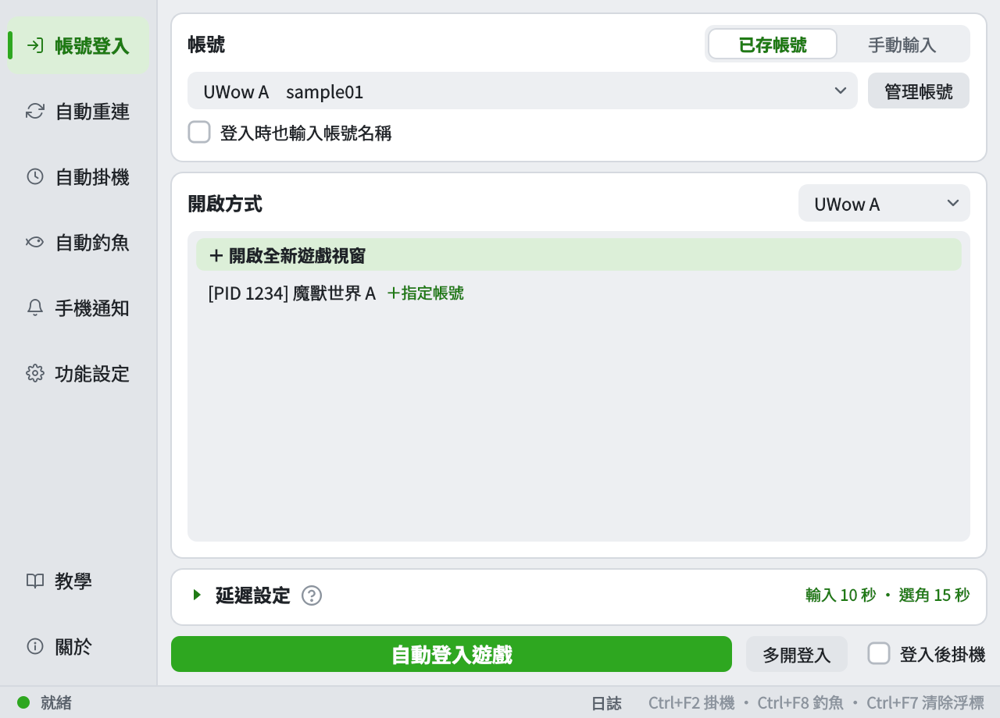
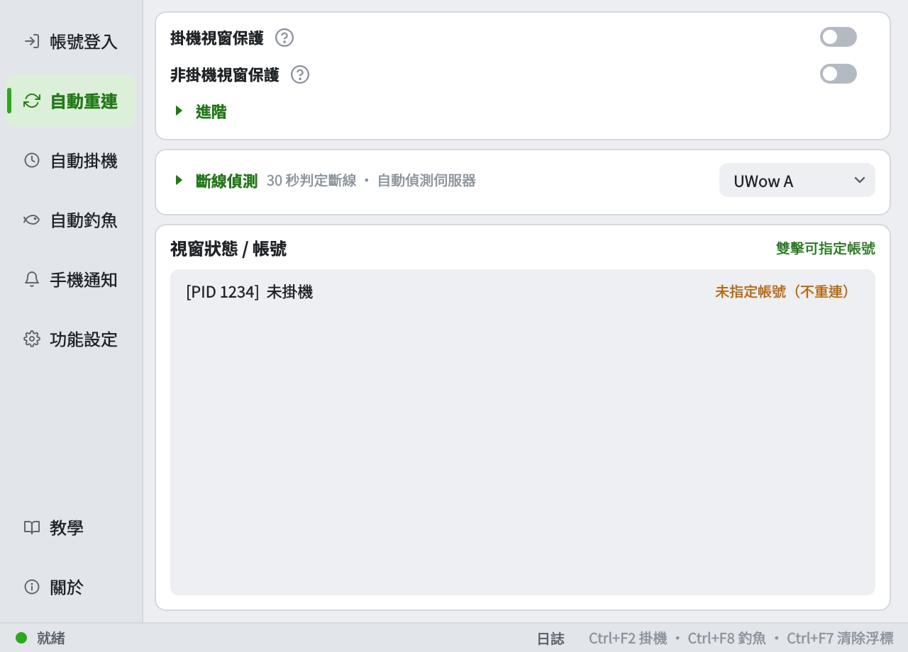
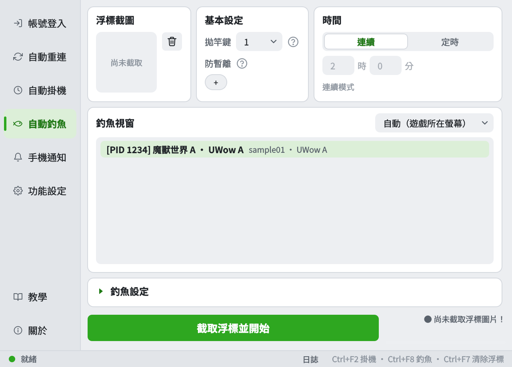
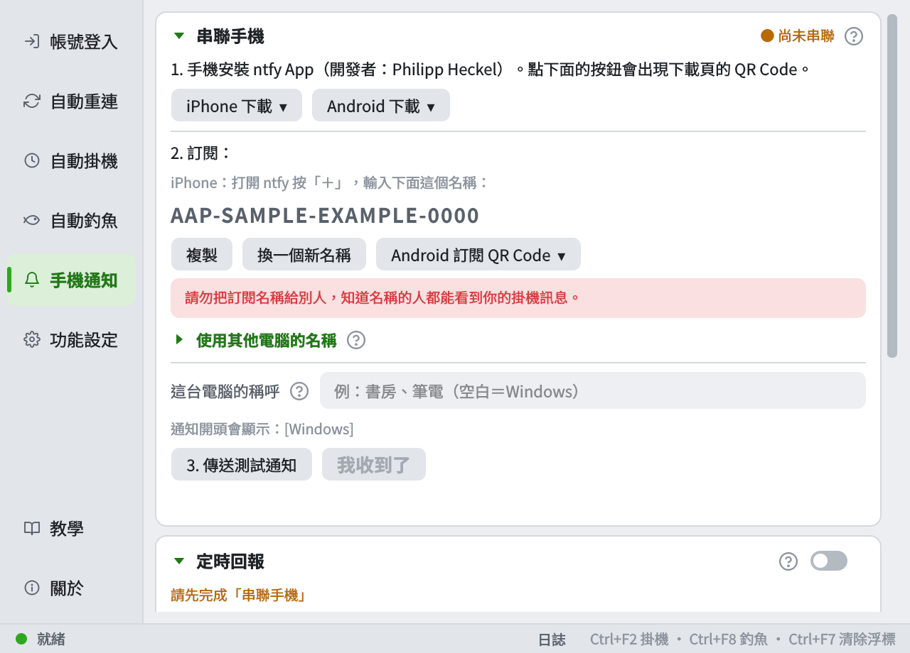
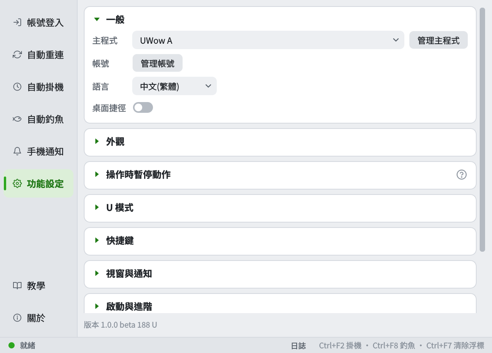
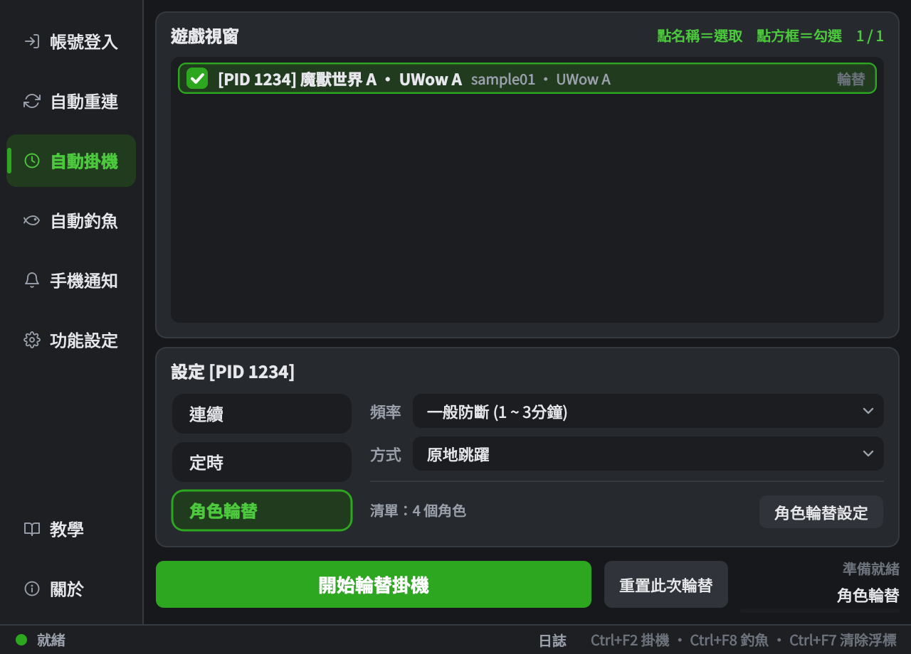

# Azeroth AFK Pulse

(原 WowAutoAFK)

 

 

## 下載最新版本 / Download

| 版本 / Edition | Windows | macOS |
|---|:---:|:---:|
| **Azeroth AFK Pulse for U** U 服（7.3.5）/ U server (7.3.5) |  |  |
| **Azeroth AFK Pulse** 一般版 / General edition |  |  |

> 不是 U 服（7.3.5）玩家請斟酌下載。for U 版本專為 U 服設計，不保證可在所有 7.3.5 版本上運行。 
> If you do not play on the U server (7.3.5), please consider carefully before downloading the for U edition.

所有版本請見 [Releases](https://github.com/yaotingshiu/azeroth-afk-pulse-releases/releases) / All versions are under Releases.

 

## 介面截圖 / Screenshots

點擊展開 / Click to expand

 

 自動掛機 / AFK  
 角色輪替設定 / Character rotation  
 帳號登入 / Login  
 斷線重連 / Reconnect  
 自動釣魚 / Fishing  
 手機通知 / Phone alerts  
 功能設定 / Settings  
 深色主題 / Dark theme  
 懸浮視窗 / Floating window

 

## 說明 / Documentation

<b>繁體中文</b>

## 簡介

Azeroth AFK Pulse 是一款專為《魔獸世界》設計的掛機與釣魚工具，支援 Windows 與 macOS，完全免費。它把多開登入、掛機防暫離、斷線重連與角色輪替整合在同一個介面中，讓你同時掛多個遊戲視窗，不必一直守在電腦前。

### 核心特色

- **多開與多視窗掛機**：一次開啟並登入多個遊戲視窗，每個視窗各自設定、各自掛機，並可在背景同時執行。
- **斷線自動重連**：偵測到斷線後自動重新開啟遊戲並登入，回到原本的角色繼續掛機。
- **自動切換角色**：依照你排好的角色清單，時間到就自動換下一個角色；多個視窗可以同時各自輪替。
- **手機通知（ntfy）**：斷線、恢復連線、換角色、任務開始與結束等狀況即時推送到手機，人不在電腦前也能掌握掛機狀態。
- **自動釣魚**：依你截取的浮標圖片自動拋竿與收竿。
- **不侵入遊戲**：不讀寫遊戲記憶體、不注入程式碼，只靠畫面辨識與模擬鍵盤滑鼠運作（見下方「運作原理」）。

### 兩個版本

| 版本 | 適用 |
|---|---|
| **Azeroth AFK Pulse for U** | U 服（7.3.5） |
| **Azeroth AFK Pulse**（一般版） | 其他伺服器 |

> **不是 U 服（7.3.5）玩家，請斟酌下載。** for U 版本專為 U 服設計，不保證可在所有 7.3.5 版本上運行。

兩個版本可以同時安裝在同一台電腦上，設定與紀錄各自獨立。

## 運作原理

本程式**不讀取或修改遊戲記憶體、不注入任何程式碼、不修改遊戲檔案**。所有功能都只透過畫面辨識判斷遊戲狀態，再模擬鍵盤與滑鼠操作完成。

for U 版會另外安裝一個遊戲插件，使用的是遊戲官方開放的插件介面（AddOns），用來在畫面上顯示資訊供程式辨識；解除安裝時可一併移除。

建議將遊戲的顯示模式設為 **「視窗（全螢幕）」**，畫面辨識與視窗切換最為穩定。

## 主要功能

- **帳號登入**：儲存多組帳號，一鍵自動登入，可同時開啟多個遊戲視窗。
- **斷線自動重連**：偵測到斷線後自動重新登入，回到原本的角色繼續掛機。
- **自動掛機**：提供循環、定時與角色輪替三種方式，每個遊戲視窗各自設定，可在背景執行。
- **角色輪替掛機**：每個遊戲視窗可依清單輪流掛不同角色；同一個視窗內輪替的是同一個帳號、同一個伺服器的角色。多個視窗可以同時各自輪替。
- **自動釣魚**：依你截取的浮標圖片自動拋竿與收竿。
- **手機通知**：斷線、恢復連線、換角色、任務開始與結束等狀況，即時推送到手機。
- **懸浮視窗**：不開啟主視窗也能查看與控制目前的任務。
- **for U 版專屬**：搭配專用遊戲插件，依伺服器記錄的掛機時間換角色，達標後自動領取獎勵。
- 介面支援繁體中文、简体中文與 English，並提供淺色與深色主題。

### 釣魚的限制

為了遵守不侵入遊戲的原則，釣魚只靠影像辨識與控制鍵盤滑鼠完成，因此：

- 同一時間只能有**一個**遊戲視窗釣魚。
- 釣魚中的遊戲視窗必須保持在**前景**，無法在背景執行。

## for U 版遊戲插件

for U 版附帶一個專用的遊戲插件「Azeroth AFK Pulse for U」，由程式自動安裝與更新，不需要自己下載。插件與程式即時連動，讓 U 服的掛機更省事：

- **今日掛機進度**：在遊戲畫面上以狀態條顯示伺服器記錄的今日掛機時間、距離達標還有多久，以及獎勵是否已領取。狀態條可以拖動、縮放與鎖定。
- **自動領取獎勵**：掛機時間達標後自動領取獎勵，可選擇不顯示獎勵視窗、在背景領取。
- **依伺服器時間換角色**：每個角色可以設定自己的目標分鐘數（預設掛滿 120 分），達標後由程式自動換下一個角色。如果時間到時你正在打字、操作角色，或在副本、隊伍中，插件會先詢問你要現在換還是稍後再換，不會直接打斷你。
- **遊戲內管理輪替清單**：在遊戲內就能查看與調整輪替順序（拖動排序）、加入或移除角色、暫停輪替，或立即換下一個角色；修改約 2 秒就會同步到程式。
- **自動功能**（全部預設關閉，勾選後立即生效）：開商人時自動修裝、自動賣灰色物品；競技場／戰場結束自動離開；自動確認隨機隊伍職責、自動回應準備確認；自動拒絕決鬥、自動接受復活、自動跳過過場動畫。
- **釣魚功能**：自動拾取，以及手上拿著釣竿時快速按兩下右鍵就能拋竿。
- **聊天指令**：`/aap` 開關設定、`/aap hud` 開關狀態條、`/aap pause` 暫停／繼續輪替、`/aap next` 立即換下一個角色。

插件只使用遊戲官方開放的插件介面（AddOns），不修改任何遊戲檔案；解除安裝程式時可以選擇一併移除。

## 系統需求

- **Windows**：Windows 10（1809 以後）或 Windows 11，64 位元。不支援 32 位元的 Windows，以及 Windows 7、8。程式需要系統管理員權限，才能對遊戲送出鍵盤與滑鼠操作。
- **macOS**：macOS 14 Sonoma 或更新版本。Intel 處理器的 Mac 可直接執行，Apple 晶片的 Mac 透過 Rosetta 執行。
- **for U 版**：U 服（7.3.5）的遊戲用戶端。

## 下載

點本頁最上方的下載按鈕，即可直接下載最新版本。

所有版本（包含舊版本）都在本頁右側的 **Releases**，每個版本同時包含 for U 版與一般版的安裝檔，更新內容也寫在各自的 Release 中。

| 檔案 | 說明 |
|---|---|
| `AzerothAFKPulse-for-U-Setup.exe` | for U 版，Windows 安裝程式 |
| `AzerothAFKPulse-for-U-mac.dmg` | for U 版，macOS |
| `AzerothAFKPulse-Setup.exe` | 一般版，Windows 安裝程式 |
| `AzerothAFKPulse-mac.dmg` | 一般版，macOS |

Releases 中的 `…-mac.zip` 是程式自動更新用的檔案，不需要手動下載。

## 安裝

### Windows

1. 執行下載的 `…-Setup.exe`。
2. 如果出現「Windows 已保護您的電腦」，按「其他資訊」→「仍要執行」。
3. 出現系統管理員權限的詢問時，按「是」。
4. 依照安裝畫面完成安裝，預設安裝位置為 `C:\AzerothAFKPulse for U` 或 `C:\AzerothAFKPulse`。

### macOS

1. 打開下載的 `…-mac.dmg`，把程式拖到「應用程式」資料夾。
2. 第一次開啟如果被擋下，到「系統設定 → 隱私權與安全性」，在下方按「強制打開」。
3. 依程式提示，在「系統設定 → 隱私權與安全性」允許「輔助使用」、「輸入監控」與「螢幕錄製」。

## 更新

程式會自動檢查新版本，有新版時會跳出通知，在程式內按一下就能更新，設定與紀錄都會保留。

- 也可以到「功能設定 → 更新」手動檢查。
- 更新檔都經過數位簽章驗證，驗證不通過的檔案不會被安裝。
- 更新失敗時會自動退回原本的版本。

## 解除安裝

- **Windows**：程式內「功能設定 → 資料 → 解除安裝」，或 Windows 的「設定 → 應用程式」。
- **macOS**：程式內「功能設定 → 資料 → 解除安裝」。

解除安裝時可以選擇是否一併刪除設定與紀錄，以及是否移除遊戲插件（for U 版）。

## 資料存放位置

| | Windows | macOS |
|---|---|---|
| for U 版 | `%AppData%\AzerothAFKPulse for U` | `~/Library/Application Support/AzerothAFKPulse for U` |
| 一般版 | `%AppData%\AzerothAFKPulse` | `~/Library/Application Support/AzerothAFKPulse` |

更新或重新安裝都不會覆蓋這些資料。

## 常見問題

**遊戲收不到按鍵？**
Windows 請確認程式以系統管理員身分執行（預設即是），並在「功能設定」選擇正確的遊戲。Mac 請確認已允許「輔助使用」、「輸入監控」與「螢幕錄製」。

**清單裡找不到遊戲視窗？**
到「功能設定 → 啟動與進階 → 自訂進程」，加入遊戲的處理程序名稱（不含 .exe）。

**防毒軟體顯示警告，或判定有風險？**
這是這類工具常見的誤判。防毒軟體多半依程式的「行為」判斷風險，而本程式為了完成掛機與釣魚，必須做下列這些動作，剛好都是防毒軟體會特別留意的：

- **模擬鍵盤與滑鼠**：對遊戲視窗送出按鍵與點擊，例如原地跳躍、拋竿。
- **擷取並辨識螢幕畫面**：判斷遊戲目前的狀態，以及找出釣魚浮標的位置。
- **偵測鍵盤與滑鼠是否有動作**：用來判斷你是否正在操作遊戲，以及接收快速鍵；只判斷有沒有在操作，不會記錄你按了什麼。
- **啟動遊戲並自動輸入帳號密碼**：用於自動登入與斷線重連。
- **查詢遊戲的處理程序與網路連線**：用來找到遊戲視窗、判斷是否斷線。
- **寫入遊戲的插件資料夾**（for U 版）：安裝與更新專用的遊戲插件。
- **以系統管理員權限執行**（Windows）：才能對遊戲送出鍵盤與滑鼠操作。

此外，本程式使用 Nuitka 將 Python 程式碼編譯成執行檔，這種方式產生的檔案結構與一般程式不同，部分防毒軟體的啟發式掃描容易將其列為可疑；加上程式未使用商業程式碼簽章憑證，且是剛發布、下載量還不多的新程式，也會讓 Windows SmartScreen 等機制提高警示。

作者保證：本程式不含任何病毒、木馬或惡意程式碼，也不會竊取或上傳你的帳號密碼與任何個人資料（詳見「隱私權政策」）。程式的更新也只來自本頁：程式讀取本頁的 `u.json`／`general.json` 取得最新版本資訊，並只從本頁的 Releases 下載更新檔；每個檔案都經過數位簽章驗證，被竄改過的檔案不會被安裝。

如果防毒軟體攔截了本程式，可以將程式的安裝資料夾加入防毒軟體的排除清單。安全與否最終仍應以你自己的判斷為準；若你對此有任何疑慮，建議不要下載或安裝本程式。

**會被偵測嗎？**
本程式不讀寫遊戲記憶體，只透過畫面辨識與模擬鍵盤滑鼠運作。但任何第三方工具都可能違反遊戲規章，請自行評估風險。

更多說明請看程式內的「教學」頁面。

<b>简体中文</b>

## 简介

Azeroth AFK Pulse 是一款专为《魔兽世界》设计的挂机与钓鱼工具，支持 Windows 与 macOS，完全免费。它把多开登录、挂机防暂离、断线重连与角色轮替集成在同一个界面中，让你同时挂多个游戏窗口，不必一直守在电脑前。

### 内核特色

- **多开与多窗口挂机**：一次打开并登录多个游戏窗口，每个窗口各自设置、各自挂机，并可在后台同时运行。
- **断线自动重连**：检测到断线后自动重新打开游戏并登录，回到原本的角色继续挂机。
- **自动切换角色**：依照你排好的角色清单，时间到就自动换下一个角色；多个窗口可以同时各自轮替。
- **手机通知（ntfy）**：断线、恢复连接、换角色、任务开始与结束等状况即时推送到手机，人不在电脑前也能掌握挂机状态。
- **自动钓鱼**：依你截取的浮标图片自动抛竿与收竿。
- **不侵入游戏**：不读写游戏内存、不注入代码，只靠画面辨识与模拟键盘鼠标运作（见下方「运作原理」）。

### 两个版本

| 版本 | 适用 |
|---|---|
| **Azeroth AFK Pulse for U** | U 服（7.3.5） |
| **Azeroth AFK Pulse**（一般版） | 其他服务器 |

> **不是 U 服（7.3.5）玩家，请斟酌下载。** for U 版本专为 U 服设计，不保证可在所有 7.3.5 版本上运行。

两个版本可以同时安装在同一台电脑上，设置与记录各自独立。

## 运作原理

本程序**不读取或修改游戏内存、不注入任何代码、不修改游戏文件**。所有功能都只通过画面辨识判断游戏状态，再模拟键盘与鼠标操作完成。

for U 版会另外安装一个游戏插件，使用的是游戏官方开放的插件接口（AddOns），用来在画面上显示信息供程序辨识；卸载时可一并移除。

建议将游戏的显示模式设为 **「窗口（全屏幕）」**，画面辨识与窗口切换最为稳定。

## 主要功能

- **账号登录**：保存多组账号，一键自动登录，可同时打开多个游戏窗口。
- **断线自动重连**：检测到断线后自动重新登录，回到原本的角色继续挂机。
- **自动挂机**：提供循环、定时与角色轮替三种方式，每个游戏窗口各自设置，可在后台运行。
- **角色轮替挂机**：每个游戏窗口可依清单轮流挂不同角色；同一个窗口内轮替的是同一个账号、同一个服务器的角色。多个窗口可以同时各自轮替。
- **自动钓鱼**：依你截取的浮标图片自动抛竿与收竿。
- **手机通知**：断线、恢复连接、换角色、任务开始与结束等状况，即时推送到手机。
- **悬浮窗口**：不打开主窗口也能查看与控制目前的任务。
- **for U 版专属**：搭配专用游戏插件，依服务器记录的挂机时间换角色，达标后自动领取奖励。
- 界面支持繁体中文、简体中文与 English，并提供浅色与深色主题。

### 钓鱼的限制

为了遵守不侵入游戏的原则，钓鱼只靠影像辨识与控制键盘鼠标完成，因此：

- 同一时间只能有**一个**游戏窗口钓鱼。
- 钓鱼中的游戏窗口必须保持在**前台**，无法在后台运行。

## for U 版游戏插件

for U 版附带一个专用的游戏插件「Azeroth AFK Pulse for U」，由程序自动安装与更新，不需要自己下载。插件与程序即时连动，让 U 服的挂机更省事：

- **今日挂机进度**：在游戏画面上以状态条显示服务器记录的今日挂机时间、距离达标还有多久，以及奖励是否已领取。状态条可以拖动、缩放与锁定。
- **自动领取奖励**：挂机时间达标后自动领取奖励，可选择不显示奖励窗口、在后台领取。
- **依服务器时间换角色**：每个角色可以设置自己的目标分钟数（默认挂满 120 分），达标后由程序自动换下一个角色。如果时间到时你正在打字、操作角色，或在副本、队伍中，插件会先询问你要现在换还是稍后再换，不会直接打断你。
- **游戏内管理轮替清单**：在游戏内就能查看与调整轮替顺序（拖动排序）、加入或移除角色、暂停轮替，或立即换下一个角色；修改约 2 秒就会同步到程序。
- **自动功能**（全部默认关闭，勾选后立即生效）：开商人时自动修装、自动卖灰色物品；竞技场／战场结束自动离开；自动确认随机队伍职责、自动回应准备确认；自动拒绝决斗、自动接受复活、自动跳过过场动画。
- **钓鱼功能**：自动拾取，以及手上拿着钓竿时快速按两下右键就能抛竿。
- **聊天指令**：`/aap` 开关设置、`/aap hud` 开关状态条、`/aap pause` 暂停／继续轮替、`/aap next` 立即换下一个角色。

插件只使用游戏官方开放的插件接口（AddOns），不修改任何游戏文件；卸载程序时可以选择一并移除。

## 系统需求

- **Windows**：Windows 10（1809 以后）或 Windows 11，64 位。不支持 32 位的 Windows，以及 Windows 7、8。程序需要管理员权限，才能对游戏送出键盘与鼠标操作。
- **macOS**：macOS 14 Sonoma 或更高版本。Intel 处理器的 Mac 可直接运行，Apple 芯片的 Mac 通过 Rosetta 运行。
- **for U 版**：U 服（7.3.5）的游戏客户端。

## 下载

点本页最上方的下载按钮，即可直接下载最新版本。

所有版本（包含旧版本）都在本页右侧的 **Releases**，每个版本同时包含 for U 版与一般版的安装档，更新内容也写在各自的 Release 中。

| 文件 | 说明 |
|---|---|
| `AzerothAFKPulse-for-U-Setup.exe` | for U 版，Windows 安装程序 |
| `AzerothAFKPulse-for-U-mac.dmg` | for U 版，macOS |
| `AzerothAFKPulse-Setup.exe` | 一般版，Windows 安装程序 |
| `AzerothAFKPulse-mac.dmg` | 一般版，macOS |

Releases 中的 `…-mac.zip` 是程序自动更新用的文件，不需要手动下载。

## 安装

### Windows

1. 运行下载的 `…-Setup.exe`。
2. 如果出现「Windows 已保护你的电脑」，点击「更多信息」→「仍要运行」。
3. 出现管理员权限的询问时，按「是」。
4. 依照安装画面完成安装，默认安装位置为 `C:\AzerothAFKPulse for U` 或 `C:\AzerothAFKPulse`。

### macOS

1. 打开下载的 `…-mac.dmg`，把程序拖到「应用程序」文件夹。
2. 第一次打开如果被挡下，到「系统设置 → 隐私与安全性」，在下方按「仍要打开」。
3. 依程序提示，在「系统设置 → 隐私与安全性」允许「辅助功能」、「输入监控」与「屏幕录制」。

## 更新

程序会自动检查新版本，有新版时会跳出通知，在程序内按一下就能更新，设置与记录都会保留。

- 也可以到「功能设置 → 更新」手动检查。
- 更新文件都经过数字签名验证，验证不通过的文件不会被安装。
- 更新失败时会自动退回原本的版本。

## 卸载

- **Windows**：程序内「功能设置 → 数据 → 卸载」，或 Windows 的「设置 → 应用」。
- **macOS**：程序内「功能设置 → 数据 → 卸载」。

卸载时可以选择是否一并删除设置与记录，以及是否移除游戏插件（for U 版）。

## 数据存放位置

| | Windows | macOS |
|---|---|---|
| for U 版 | `%AppData%\AzerothAFKPulse for U` | `~/Library/Application Support/AzerothAFKPulse for U` |
| 一般版 | `%AppData%\AzerothAFKPulse` | `~/Library/Application Support/AzerothAFKPulse` |

更新或重新安装都不会覆盖这些数据。

## 常见问题

**游戏收不到按键？**
Windows 请确认程序以管理员身份运行（默认即是），并在「功能设置」选择正确的游戏。Mac 请确认已允许「辅助功能」、「输入监控」与「屏幕录制」。

**清单里找不到游戏窗口？**
到「功能设置 → 启动与高级 → 自定义进程」，加入游戏的进程名称（不含 .exe）。

**杀毒软件显示警告，或判定有风险？**
这是这类工具常见的误判。杀毒软件多半依程序的「行为」判断风险，而本程序为了完成挂机与钓鱼，必须做下列这些动作，刚好都是杀毒软件会特别留意的：

- **模拟键盘与鼠标**：对游戏窗口送出按键与点击，例如原地跳跃、抛竿。
- **截取并辨识屏幕画面**：判断游戏目前的状态，以及找出钓鱼浮标的位置。
- **检测键盘与鼠标是否有动作**：用来判断你是否正在操作游戏，以及接收快捷键；只判断有没有在操作，不会记录你按了什么。
- **启动游戏并自动输入账号密码**：用于自动登录与断线重连。
- **查找游戏的进程与网络连接**：用来找到游戏窗口、判断是否断线。
- **写入游戏的插件文件夹**（for U 版）：安装与更新专用的游戏插件。
- **以管理员权限运行**（Windows）：才能对游戏送出键盘与鼠标操作。

此外，本程序使用 Nuitka 将 Python 代码编译成运行档，这种方式产生的文件结构与一般程序不同，部分杀毒软件的启发式扫描容易将其列为可疑；加上程序未使用商业代码签名凭证，且是刚发布、下载量还不多的新程序，也会让 Windows SmartScreen 等机制提高警示。

作者保证：本程序不含任何病毒、木马或恶意代码，也不会窃取或上传你的账号密码与任何个人数据（详见「隐私政策」）。程序的更新也只来自本页：程序读取本页的 `u.json`／`general.json` 取得最新版本信息，并只从本页的 Releases 下载更新文件；每个文件都经过数字签名验证，被窜改过的文件不会被安装。

如果杀毒软件拦截了本程序，可以将程序的安装文件夹加入杀毒软件的排除清单。安全与否最终仍应以你自己的判断为准；若你对此有任何疑虑，建议不要下载或安装本程序。

**会被检测吗？**
本程序不读写游戏内存，只通过画面辨识与模拟键盘鼠标运作。但任何第三方工具都可能违反游戏规章，请自行评估风险。

更多说明请看程序内的「教学」页面。

<b>English</b>

## Overview

Azeroth AFK Pulse is a free AFK and fishing tool built for World of Warcraft, available for Windows and macOS. It brings multi-client login, anti-AFK, auto reconnect and character rotation together in one interface, so you can keep several game windows running without having to stay at your computer.

### Highlights

- **Multi-boxing and multi-window AFK**: open and log in to several game windows at once; each window has its own settings and AFK task, and they can all run in the background at the same time.
- **Auto reconnect**: after a disconnect, the game is reopened and logged in again automatically, and you return to the same character to continue.
- **Automatic character switching**: when the time is up, the next character on your list is switched in automatically; several windows can rotate at the same time.
- **Phone alerts (ntfy)**: disconnects, reconnects, character switches, tasks starting and ending are pushed to your phone as they happen, so you always know the AFK status even away from your computer.
- **Auto fishing**: casts and reels in automatically, based on a picture of the bobber you capture.
- **Non-intrusive**: never reads or writes game memory or injects code; it works only through screen recognition and simulated keyboard and mouse input (see "How it works" below).

### Two editions

| Edition | For |
|---|---|
| **Azeroth AFK Pulse for U** | U server (7.3.5) |
| **Azeroth AFK Pulse** (general) | Other servers |

> **If you do not play on the U server (7.3.5), please consider carefully before downloading.** The for U edition is designed specifically for the U server and is not guaranteed to work on every 7.3.5 client.

Both editions can be installed on the same computer; their settings and records are kept separately.

## How it works

The program **does not read or modify game memory, inject any code or modify game files**. Every feature works only by recognizing what is on the screen and simulating keyboard and mouse input.

The for U edition also installs a game add-on that uses the game's official add-on interface (AddOns) to show information on screen for the program to read; it can be removed when uninstalling.

Setting the game's display mode to **"Windowed (Fullscreen)"** gives the most reliable screen recognition and window switching.

## Features

- **Login**: save several accounts and log in with one click; multiple game windows are supported.
- **Auto reconnect**: logs in again after a disconnect and goes back to the same character to continue.
- **AFK**: loop, timed and character rotation modes, set per game window and able to run in the background.
- **Character rotation**: each game window can rotate through a list of characters; the characters in one window share the same account and the same server. Several windows can rotate at the same time.
- **Fishing**: casts and reels in automatically, based on a picture of the bobber you capture.
- **Phone alerts**: disconnects, reconnects, character switches, tasks starting and ending, sent to your phone as they happen.
- **Floating window**: see and control the current task without opening the main window.
- **for U edition only**: works with its own game add-on to switch characters by the AFK time the server records, and claims the reward automatically.
- Interface in Traditional Chinese, Simplified Chinese and English, with light and dark themes.

### Fishing limits

To keep to the rule of never intruding into the game, fishing relies only on image recognition and keyboard and mouse control. As a result:

- Only **one** game window can fish at a time.
- The fishing window must stay in the **foreground**; fishing cannot run in the background.

## The for U game add-on

The for U edition comes with its own game add-on, "Azeroth AFK Pulse for U", which the program installs and updates for you; there is nothing to download separately. The add-on works hand in hand with the program to make AFK on the U server easier:

- **Today's AFK progress**: a status bar in the game shows today's AFK time as recorded by the server, how long until the target, and whether the reward has been claimed. The bar can be moved, resized and locked.
- **Automatic reward**: once the AFK time reaches the target, the reward is claimed automatically, optionally in the background without showing the reward window.
- **Switching by the server's AFK time**: each character can have its own target in minutes (full 120 minutes by default); when it is reached, the program switches to the next character. If you are typing, moving your character, or in an instance or a group at that moment, the add-on first asks whether to switch now or later instead of interrupting you.
- **Manage the rotation in the game**: view and change the rotation order (drag to reorder), add or remove characters, pause the rotation or switch to the next character right away, all inside the game; changes reach the program within about 2 seconds.
- **Automation** (all off by default, takes effect as soon as it is ticked): repair and sell grey items at merchants; leave finished arenas and battlegrounds; accept dungeon role checks and answer ready checks; decline duels, accept resurrections and skip cinematics.
- **Fishing help**: auto loot, and a quick double right-click casts while a fishing pole is in hand.
- **Chat commands**: `/aap` opens the settings, `/aap hud` shows or hides the status bar, `/aap pause` pauses or resumes the rotation, `/aap next` switches to the next character right away.

The add-on uses only the game's official add-on interface (AddOns) and never modifies any game file; it can be removed together with the program when uninstalling.

## Requirements

- **Windows**: Windows 10 (version 1809 or later) or Windows 11, 64-bit. 32-bit Windows, Windows 7 and Windows 8 are not supported. The program needs administrator rights to send keyboard and mouse input to the game.
- **macOS**: macOS 14 Sonoma or later. Runs natively on Intel Macs and through Rosetta on Apple silicon Macs.
- **for U edition**: the U server (7.3.5) game client.

## Download

Use the download buttons at the top of this page to get the latest version directly.

Every version, including older ones, is under **Releases** on the right of this page. Each version contains both the for U and the general edition, and lists its changes.

| File | Description |
|---|---|
| `AzerothAFKPulse-for-U-Setup.exe` | for U edition, Windows installer |
| `AzerothAFKPulse-for-U-mac.dmg` | for U edition, macOS |
| `AzerothAFKPulse-Setup.exe` | General edition, Windows installer |
| `AzerothAFKPulse-mac.dmg` | General edition, macOS |

The `…-mac.zip` files in Releases are used by the program's automatic updates; there is no need to download them.

## Installation

### Windows

1. Run the downloaded `…-Setup.exe`.
2. If "Windows protected your PC" appears, click "More info" and then "Run anyway".
3. Click "Yes" when asked for administrator rights.
4. Follow the installer. The default location is `C:\AzerothAFKPulse for U` or `C:\AzerothAFKPulse`.

### macOS

1. Open the downloaded `…-mac.dmg` and drag the app to the Applications folder.
2. If the first launch is blocked, go to System Settings > Privacy & Security and click "Open Anyway".
3. When the program asks, allow "Accessibility", "Input Monitoring" and "Screen Recording" in System Settings > Privacy & Security.

## Updates

The program checks for new versions itself and shows a notice when one is available; one click in the program updates it, and your settings and records are kept.

- You can also check by hand in Settings > Updates.
- Every update is checked against a digital signature; a file that fails the check is never installed.
- If an update fails, the previous version is restored automatically.

## Uninstall

- **Windows**: Settings > Data > Uninstall in the program, or Windows Settings > Apps.
- **macOS**: Settings > Data > Uninstall in the program.

When uninstalling you can choose whether to delete your settings and records as well, and whether to remove the game add-on (for U edition).

## Where data is stored

| | Windows | macOS |
|---|---|---|
| for U edition | `%AppData%\AzerothAFKPulse for U` | `~/Library/Application Support/AzerothAFKPulse for U` |
| General edition | `%AppData%\AzerothAFKPulse` | `~/Library/Application Support/AzerothAFKPulse` |

Updating or reinstalling never overwrites this data.

## FAQ

**The game does not receive keys?**
On Windows, make sure the program runs as administrator (the default) and that the right game is selected in Settings. On a Mac, make sure "Accessibility", "Input Monitoring" and "Screen Recording" are allowed.

**The game window is not in the list?**
Add the game's process name (without .exe) under Settings > Startup & advanced > Processes.

**My antivirus shows a warning or flags the program as a risk?**
This is a common false positive for tools of this kind. Antivirus software mostly judges risk by what a program does, and to handle AFK and fishing this program has to do the following, all of which antivirus software watches closely:

- **Simulates keyboard and mouse input**: sends key presses and clicks to the game window, such as jumping in place or casting.
- **Captures and recognizes the screen**: to tell the game's current state and find the fishing bobber.
- **Detects whether the keyboard and mouse are in use**: to tell whether you are playing and to receive hotkeys; it only checks for activity and never records which keys you press.
- **Starts the game and types in your account and password**: for auto login and auto reconnect.
- **Looks up the game's process and network connections**: to find the game windows and tell whether a disconnect happened.
- **Writes to the game's add-on folder** (for U edition): to install and update its game add-on.
- **Runs with administrator rights** (Windows): needed to send keyboard and mouse input to the game.

In addition, the program is compiled from Python into an executable with Nuitka. Files built this way are structured differently from ordinary programs, which makes some antivirus heuristics more likely to flag them. The program is also not signed with a commercial code-signing certificate and, as a newly released program, has few downloads so far, which raises warnings from mechanisms such as Windows SmartScreen.

The author guarantees that the program contains no virus, trojan or malicious code of any kind, and never steals or uploads your account passwords or any personal data (see the Privacy Policy). Updates also come only from this page: the program reads `u.json` / `general.json` on this page for the latest version information and downloads update files only from this page's Releases; every file is checked against a digital signature, and a tampered file is never installed.

If your antivirus blocks the program, you can add its installation folder to the antivirus exclusion list. Whether to trust it is ultimately your own decision; if you have any doubts, we recommend that you do not download or install it.

**Can it be detected?**
The program never reads or writes game memory; it works only through screen recognition and simulated keyboard and mouse input. Any third-party tool may still break a game's rules, so please judge the risk for yourself.

See the Guide page in the program for more help.

 

## 條款與授權 / Terms and licenses

<b>免責聲明 / Disclaimer</b>

**繁體中文**

- 本程式為個人開發、免費分享的測試工具，僅供個人測試、非商業用途。
- 嚴禁破解、反編譯、修改後重新散布本程式，亦嚴禁以任何形式販售、出租或作為付費服務的一部分。若你是付費取得本程式，請向賣家求償並告知作者。
- 本程式與暴雪娛樂（Blizzard Entertainment）無任何關聯，亦未獲其授權或認可。使用任何第三方工具都可能違反遊戲服務條款，並導致帳號警告、停權或封鎖，請自行評估風險。
- World of Warcraft 與魔獸世界為 Blizzard Entertainment, Inc. 的商標或註冊商標。
- 因使用或無法使用本程式所造成的任何損失（包含但不限於帳號處分、資料遺失、遊戲內損失），作者概不負責。
- 本程式如何處理你的資料，請參閱下方的「隱私權政策」。
- 本程式依「現狀」提供，不保證功能完全正確或持續可用；作者保留隨時修改或停止更新的權利。
- 下載、安裝或使用本程式，即表示你已閱讀並同意本免責聲明與隱私權政策。

**English**

- This program is a test tool developed by an individual and shared for free, for personal testing and non-commercial use only.
- Cracking, decompiling, or modifying and redistributing this program is strictly prohibited, as is selling or renting it or using it as part of a paid service in any form. If you paid for this program, please claim a refund from the seller and let the author know.
- This program has no connection with Blizzard Entertainment and is not authorized or endorsed by it. Using any third-party tool may violate the game's terms of service and lead to account warnings, suspensions or bans; please judge the risk for yourself.
- World of Warcraft is a trademark or registered trademark of Blizzard Entertainment, Inc.
- The author is not liable for any loss caused by using or being unable to use this program, including but not limited to account penalties, data loss and in-game losses.
- How this program handles your data is described in the Privacy Policy below.
- This program is provided "as is", without any guarantee that it works correctly or remains available; the author may change it or stop updating it at any time.
- By downloading, installing or using this program, you confirm that you have read and agree to this Disclaimer and the Privacy Policy.

<b>隱私權政策 / Privacy Policy</b>

**繁體中文**

- **不收集個人資料**：使用本程式不需要註冊或登入任何帳號；程式沒有任何使用統計、追蹤或廣告，也不會將你的資料傳送給開發者或任何第三方。你的遊戲帳號密碼只保存在你自己的電腦上（見下方「帳號密碼」）。
- **本機儲存**：設定、掛機紀錄、記錄檔與你截取的浮標圖片，都只保存在你電腦上的程式資料夾中（見「資料存放位置」）。
- **帳號密碼**：帳號密碼只保存在你的電腦上，並使用作業系統內建的加密機制保護：Windows 使用 DPAPI，與目前的 Windows 使用者帳戶綁定；macOS 存放在系統「鑰匙圈」中。加密後的資料只能在原本的電腦、原本的使用者帳戶上解開，即使將檔案複製到其他電腦或其他使用者帳戶，也無法讀取。
- **畫面辨識**：程式只在記憶體中即時分析遊戲畫面，不會保存或上傳任何畫面。
- **網路連線**：程式只會在下列情況連線：
  - **檢查與下載更新**：只連線到官方發佈頁（GitHub：https://github.com/yaotingshiu/azeroth-afk-pulse-releases），讀取最新版本號並下載經數位簽章驗證的更新檔，不會傳送你的任何資料。
  - **手機通知**（需自行開啟）：通知內容會經由 ntfy 推播服務（ntfy.sh）傳送到你的手機；未開啟時不會傳送。
  - **斷線重連**：只測試網路與遊戲伺服器能否連線，不會傳送任何資料。
  - 上述第三方服務（GitHub、ntfy）可能依其各自的隱私權政策記錄連線資訊，例如 IP 位址。
- **刪除資料**：使用程式內「功能設定 → 資料 → 全部重置」，或在解除安裝時選擇一併刪除設定與紀錄，即可刪除本程式在你電腦上的所有資料。
- **政策更新**：本政策如有修改，將公布於官方發佈頁（https://github.com/yaotingshiu/azeroth-afk-pulse-releases）。

**English**

- **No personal data collected**: you do not need to register or sign in to anything to use the program; it has no usage statistics, tracking or advertising, and sends none of your data to the developer or any third party. Your game account passwords stay on your own computer (see "Account passwords" below).
- **Stored on your computer**: settings, AFK records, log files and the bobber pictures you capture are kept only in the program's data folder on your computer (see "Where data is stored").
- **Account passwords**: account passwords are kept only on your computer and protected by the operating system's built-in encryption: DPAPI on Windows, tied to your current Windows user account, and the system Keychain on macOS. The encrypted data can only be unlocked on the same computer and the same user account; copied to another computer or another user account, it cannot be read.
- **Screen recognition**: the program analyzes the game screen in memory only, as it happens, and never saves or uploads any screen image.
- **Network connections**: the program connects to the internet only in these cases:
  - **Checking for and downloading updates**: only the official release page (GitHub: https://github.com/yaotingshiu/azeroth-afk-pulse-releases), to read the latest version number and download update files verified by digital signature. None of your data is sent.
  - **Phone alerts** (only if you turn them on): the alert text is sent to your phone through the ntfy push service (ntfy.sh). Nothing is sent while alerts are off.
  - **Auto reconnect**: only tests whether the internet and the game server can be reached. No data is sent.
  - The third-party services above (GitHub, ntfy) may record connection information such as your IP address under their own privacy policies.
- **Deleting your data**: Settings > Data > Reset all in the program, or choosing to delete settings and records when uninstalling, removes all of the program's data from your computer.
- **Changes**: any change to this policy will be published on the official release page (https://github.com/yaotingshiu/azeroth-afk-pulse-releases).

<b>第三方軟體授權 / Third-party software</b>

本程式使用了下列開源軟體，各自依其授權條款使用 / The program uses the open-source software below, each under its own license.

| 軟體 / Software | 用途 / Purpose | 授權 / License |
|---|---|---|
| Python | 執行環境 / Runtime | PSF License |
| Qt / PySide6 | 使用者介面 / User interface | LGPL-3.0 |
| OpenCV | 畫面辨識 / Screen recognition | Apache-2.0 |
| NumPy | 數值運算 / Numerics | BSD-3-Clause |
| Pillow | 圖片處理 / Images | MIT-CMU |
| psutil | 處理程序管理 / Process handling | BSD-3-Clause |
| python-mss | 畫面擷取 / Screen capture | MIT |
| qrcode | 手機通知的 QR Code / QR code for phone alerts | BSD-3-Clause |
| PyObjC | macOS 系統介面 / macOS system interfaces | MIT |

OpenCV 附帶的多媒體函式庫依其各自的授權條款使用 / The multimedia libraries bundled with OpenCV are used under their own licenses.

完整的授權條文收錄在程式安裝資料夾中的 `THIRD_PARTY_LICENSES.txt` / The full license texts are in `THIRD_PARTY_LICENSES.txt` in the program's installation folder.

 

## 聯絡與支持 / Support the Developer & Info

- 開發者 / Developer：RTIN Studio by Hsu Yao Ting
- 網站 / Site：https://rtin-studio.pages.dev
- Email：[rtinstudio@gmail.com](mailto:rtinstudio@gmail.com)
- 微信 / WeChat：ting0427mei
- QQ：744268839
- 如果它對你有幫助，歡迎自由贊助 / Donate：[PayPal](https://www.paypal.com/ncp/payment/D7GSCCJEHTSFN)

---

© 2026 RTIN Studio by Hsu Yao Ting

